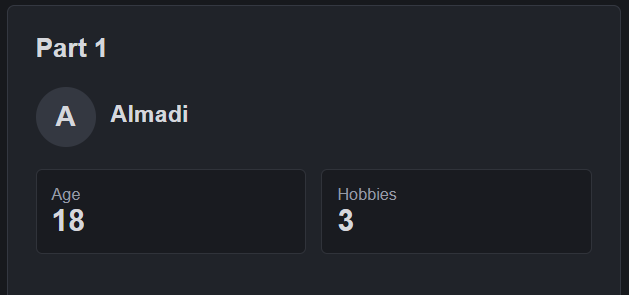
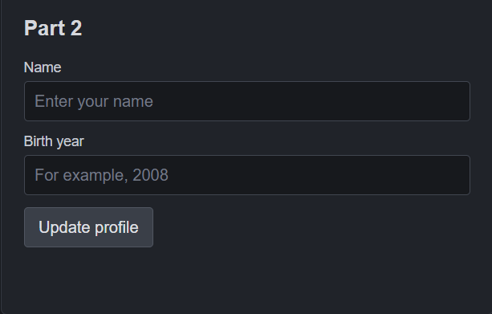
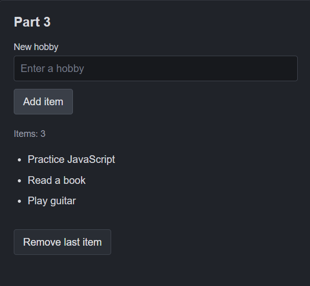

# Assignment 5 - JavaScript Basics

**Student:** Almadi Askhat  
**Group:** IT-2513

## What this project does

This is a small page made with HTML, CSS and JavaScript. It has three parts from the assignment.

## Part 1 - Profile object

I made a `userProfile` object with a name, birth year, developer status and hobbies. JavaScript calculates the approximate age and age in months. It also shows the number of hobbies and prints the data types in the browser console.

**Screenshot:** 

## Part 2 - Form

The form asks for a name and birth year. When the form is submitted, JavaScript reads the input values, checks the year, updates the object and displays the new profile. `preventDefault()` stops the page from reloading when the form is submitted.

**Screenshot:** 

## Part 3 - List

The Add Item button creates a new `li` element and adds it to the list. The Remove Last Item button removes the last element. The item count changes when the list changes.

**Screenshot:** 

## What I practiced

- JavaScript objects, arrays and data types
- Variables and calculations
- Functions and loops
- Reading values from form fields
- Handling `submit` and `click` events
- Changing HTML with DOM methods
